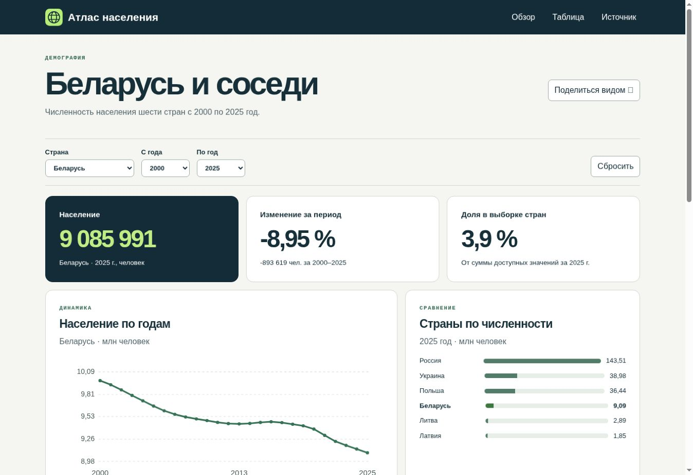

# Атлас населения

Учебный дашборд по веб-программированию, вариант 12. Показывает численность населения Беларуси и пяти соседних стран за 2000–2025 годы.

[Демо](https://atlas-naseleniya-by-36bc.friendlybud8.chatgpt.site) · [Сценарий защиты](docs/defense.md) · [Источники по странам](docs/sources.md)

## Возможности
Фильтрация по стране и периоду, сортировка трёх столбцов, постраничная таблица. Линия показывает динамику, столбцы — рейтинг, кольцо — доли в конце периода. Доступны импорт CSV, возврат к исходной выборке и ссылка на настроенный вид встроенного набора.

## Технологии и архитектура
HTML задаёт структуру и подписи. CSS Grid и Flexbox организуют карточки и адаптивные панели. JavaScript работает в браузере. SVG рисует линию, CSS — столбцы и кольцо.
- dist/data/population.csv — источник для начальной загрузки.
- dist/model.js — разбор и проверка CSV, сортировка и расчёты.
- dist/app.js — события, состояние, обновление карточек и таблицы.
- dist/charts.js — построение трёх графиков.
- scripts/serve.mjs — локальная раздача статических файлов.

## Запуск
Установить Node.js 20 или новее. Распаковать архив, открыть терминал в папке с package.json, выполнить `npm start` и открыть http://127.0.0.1:8000. Остановка — Ctrl+C. Дополнительных зависимостей нет.

## Тесты
Команда `npm test` запускает девять тестов встроенными средствами Node.js. Они проверяют контрольное значение, размер набора, CSV, фильтрацию, сортировку и расчёт процентов. В GitHub Actions предусмотрена проверка двух категорий Lighthouse с порогом 80.

## Принятые решения
Встроенный CSV загружается с того же сайта, поэтому пересмотр данных у поставщика не изменит результаты защиты. Таблица содержит точные значения, графики используют миллионы. Доля считается от суммы населения стран, для которых есть запись в конечном году. В разреженном наборе изменение требует наблюдений в обоих выбранных годах.

## Безопасность и импорт
Файл до 1 МБ обрабатывается в памяти браузера. Проверяются три поля, целые значения и уникальность страны и года. Имена выводятся как текст. Ключи, учётные записи и настройка .env для запуска не требуются. Публичного программного API у проекта нет.

## Использование ИИ
ChatGPT/Codex подготовил код приложения, выборку данных, тесты и материалы для защиты. Автотесты выполнены, стартовый экран и числовые показатели просмотрены в браузере.

## Источники данных и лицензии
Данные Всемирного банка через FRED — CC BY 4.0. Ссылки на шесть исходных таблиц и описание преобразований приведены в docs/sources.md. Использованы системные шрифты. Значок выполнен в SVG.

## Что я бы улучшил
Добавил бы сравнение нескольких выбранных стран на одном графике с базовым годом, равным 100. Тогда страны с разной численностью можно было бы сравнивать по темпам изменения.

## Лицензия
Код доступен по MIT, см. LICENSE.
